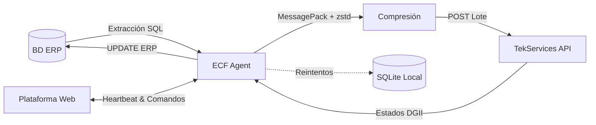

# ECF Data Collection Agent

Agente de recolección de comprobantes fiscales electrónicos (e-CF) para instalación en servidores locales de clientes y ERPs.

## ¿Qué hace este agente?

1. **Conecta** a la base de datos del sistema de facturación local (ERP).
2. **Extrae** facturas pendientes usando queries SQL configuradas localmente o heredadas desde la nube.
3. **Comprime** cada comprobante (MessagePack + zstd + base64).
4. **Transmite** hacia la plataforma TekServices en lotes optimizados.
5. **Sincroniza** de vuelta en el ERP los estados devueltos por la DGII (aceptada, rechazada, etc.).
6. **Reintenta** automáticamente facturas con fallos transitorios en una cola local persistente.
7. **Se gestiona y actualiza remotamente** desde la plataforma web mediante telemetría en tiempo real.



## Características

- 🔌 **Soporte Multi-BD**: MySQL, MariaDB, PostgreSQL, Microsoft SQL Server, Oracle y SQLite con timeouts de socket anti-bloqueo.
- 📦 **Compresión de Alto Rendimiento**: MessagePack + zstd + base64 (~35% menor tamaño y 5-10x más rápido que gzip).
- ☁️ **Gestión y Configuración Remota**: Consultas SQL, mapeos y tiempos configurables y versionables desde el CodeStudio web de TekServices (heredados por plantilla de proyecto o personalizados por emisor).
- 💾 **Persistencia y Tolerancia Offline**: La configuración remota se cachea en disco (`data/remote_config.json`); si el servidor reinicia sin Internet, el agente arranca con la última configuración recibida.
- 🔄 **Actualización Remota On-Demand y Automática**: Capacidad de actualizarse remotamente desde el panel web (tanto binarios empaquetados como despliegues desde fuente bajo `systemd`).
- 🛡️ **Cola de Reintentos Local Aislada**: Motor SQLite persistente que gestiona facturas fallidas sin bloquear la extracción principal.
- 🔢 **Mapeo Dinámico de Estados**: Traduce automáticamente los estados de DGII a códigos numéricos o personalizados del ERP.
- ⚙️ **Instaladores Automáticos para Producción**: Scripts listos para Linux (systemd) y Windows (Servicio NSSM).

---

## Instalación en Producción

Las versiones compiladas y empaquetadas están disponibles en [Releases de GitHub](https://github.com/10GO-dev/ecf-agent/releases).

### Opción A: Linux (Binario Autocontenido - Recomendado)
No requiere Python ni dependencias en el servidor:
```bash
wget https://github.com/10GO-dev/ecf-agent/releases/latest/download/ecf-agent-linux.tar.gz
tar -xzf ecf-agent-linux.tar.gz
cd ecf-agent-linux
sudo ./install-binary.sh
```

### Opción B: Linux (Código Fuente con Virtualenv)
Valida automáticamente soporte SSL e instala dependencias del sistema si faltan:
```bash
wget https://github.com/10GO-dev/ecf-agent/releases/latest/download/ecf-agent-linux.tar.gz
tar -xzf ecf-agent-linux.tar.gz
cd ecf-agent-linux
sudo ./install-source.sh
```

### Opción C: Windows (Servicio Windows)
Ejecutar PowerShell como Administrador:
```powershell
Expand-Archive ecf-agent-windows.zip -DestinationPath C:\TekServices\ECF-Agent
cd C:\TekServices\ECF-Agent
.\install.ps1
```

---

## Configuración

Toda la configuración específica del emisor puede definirse exclusivamente en el archivo `.env`:

```env
# RNC del emisor
CUSTOMER_RNC=130013454

# API Key generada en la plataforma TekServices
ECF_API_KEY=tek_live_abc123xyz...

# Conexión al ERP del cliente
DB_HOST=127.0.0.1
DB_PORT=3306
DB_NAME=erp_database
DB_USER=root
DB_PASSWORD=secret_password

# Opcionales (tienen valores por defecto automáticos)
# ECF_API_URL=https://api.tekservices.com.do
# ECF_ENVIRONMENT=DEV
```

El archivo `config/config.yaml` puede dejarse genérico o vacío en sus secciones de extracción, ya que:
1. `api.base_url` se conecta por defecto a `https://api.tekservices.com.do`.
2. `api.endpoint` usa por defecto `/private/ecf/invoices`.
3. Las consultas SQL y mapeos de datos se descargan y sincronizan automáticamente desde la plataforma TekServices según el proyecto asignado a la empresa.

---

## Gestión y Comandos Remotos

El agente reporta telemetría (heartbeat) a la plataforma TekServices cada 30 segundos y responde a comandos en tiempo real emitidos desde la interfaz web:

| Comando | Acción |
| :--- | :--- |
| `TEST_DB` | Prueba la conexión activa al ERP y mide la latencia en milisegundos. |
| `FORCE_POLL` | Dispara una extracción inmediata de comprobantes sin esperar el intervalo. |
| `FORCE_SYNC_STATUS` | Fuerza la sincronización de estados DGII con el ERP. |
| `FETCH_LOGS` | Retorna las últimas líneas del archivo de registro para diagnóstico remoto. |
| `PAUSE` / `RESUME` | Pausa o reanuda temporalmente el polling del agente. |
| `TRIGGER_UPDATE` | Comprueba y aplica la última versión del agente desde GitHub Releases. |

---

## Comandos del CLI

```bash
# Ejecutar agente en modo servicio continuo
python -m src.main run

# Modo depuración: inspecciona la extracción y muestra el JSON formateado (Dry-Run por defecto)
python -m src.main debug
python -m src.main debug --limit 3
python -m src.main debug --send          # Inspecciona y envía a la API marcando como procesado

# Ejecutar un ciclo único de polling
python -m src.main once
python -m src.main once --debug          # Ciclo único con logs detallados (DEBUG)
python -m src.main once --dry-run        # Ciclo único simulado sin modificar la base de datos

# Validar sintaxis de configuración y conectividad a base de datos
python -m src.main validate              # Alias: python -m src.main check-config

# Ver estadísticas de la cola de reintentos SQLite
python -m src.main status
```

---

## Métodos de Compresión

| Método | Descripción | Tamaño | Velocidad |
|--------|-------------|--------|-----------|
| `zstd` (default) | MessagePack + zstd + base64 | ~35% más pequeño | 5-10x más rápido |
| `gzip` | JSON + gzip + base64 | Base | Moderada |
| `none` | Sin compresión | 100% | N/A |

### Descompresión en el Servidor (Node.js)

```javascript
const { decode } = require('@msgpack/msgpack');
const { ZstdCodec } = require('zstd-codec');

async function decompressInvoiceData(compressedBase64, compressionMethod = 'zstd') {
    if (compressionMethod === 'none') {
        return JSON.parse(compressedBase64);
    }
    
    if (compressionMethod === 'gzip') {
        const zlib = require('zlib');
        const compressedBuffer = Buffer.from(compressedBase64, 'base64');
        const decompressed = zlib.gunzipSync(compressedBuffer);
        return JSON.parse(decompressed.toString('utf-8'));
    }
    
    return new Promise((resolve, reject) => {
        ZstdCodec.run(zstd => {
            try {
                const compressedBuffer = Buffer.from(compressedBase64, 'base64');
                const simple = new zstd.Simple();
                const decompressed = simple.decompress(compressedBuffer);
                const data = decode(decompressed);
                resolve(data);
            } catch (error) {
                reject(error);
            }
        });
    });
}
```

---

## Estructura del Proyecto

```
ecf-agent/
├── src/
│   ├── main.py              # CLI y ciclo de vida principal
│   ├── config.py            # Carga de configuración, variables y caché local
│   ├── updater.py           # Auto-actualizador binario y código fuente
│   ├── database/            # Conectores agnósticos (MySQL, Postgres, MSSQL, Oracle)
│   ├── sender/              # Cliente HTTP y compresión zstd/gzip
│   ├── remote/              # Heartbeat, telemetría y ejecución de comandos remotos
│   ├── queue/               # Cola SQLite de reintentos
│   └── scheduler/           # Planificador APScheduler de tareas
├── config/
│   ├── config.example.yaml  # Plantilla de configuración
│   └── mappings/            # Mappings locales opcionales
├── install-binary.sh        # Instalador Linux para binario precompilado
├── install-source.sh        # Instalador Linux para despliegue desde código fuente
├── install.ps1              # Instalador Windows Service con NSSM
├── requirements.txt         # Dependencias Python
└── data/                   # Base de datos SQLite y caché de configuración remota
```

## Licencia

MIT
